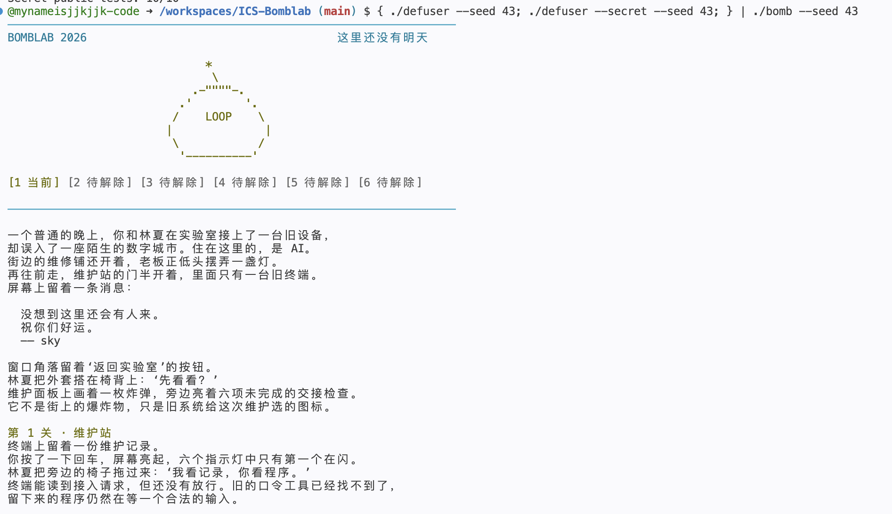
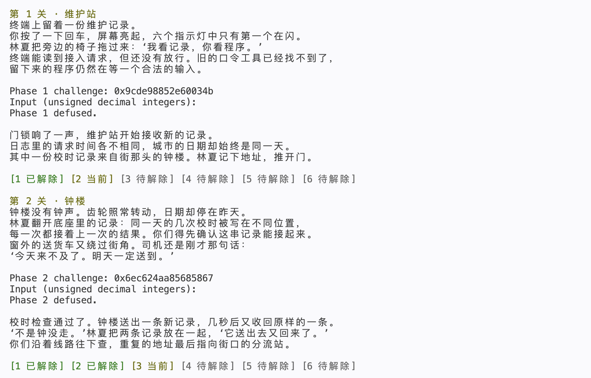
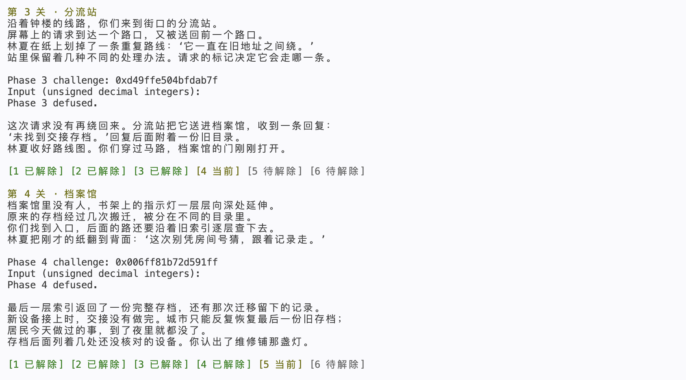
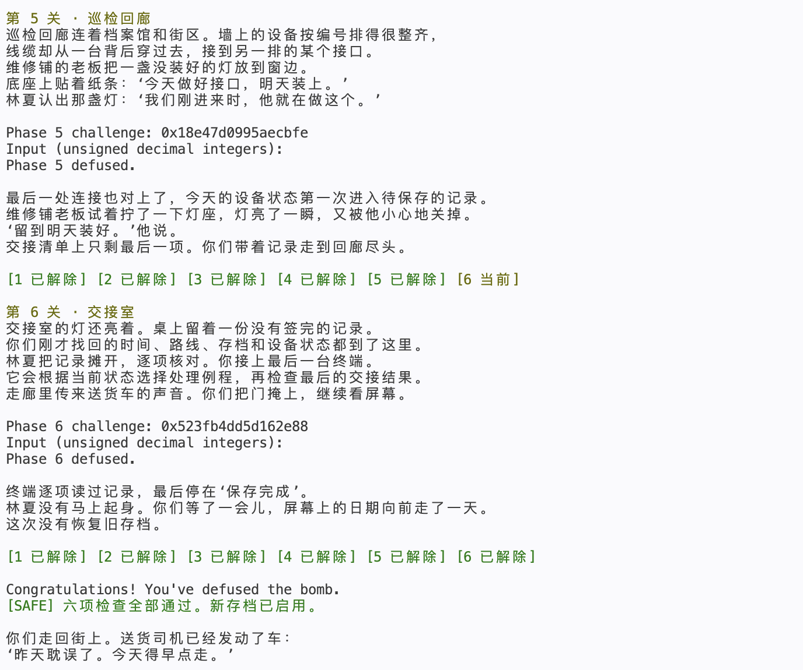
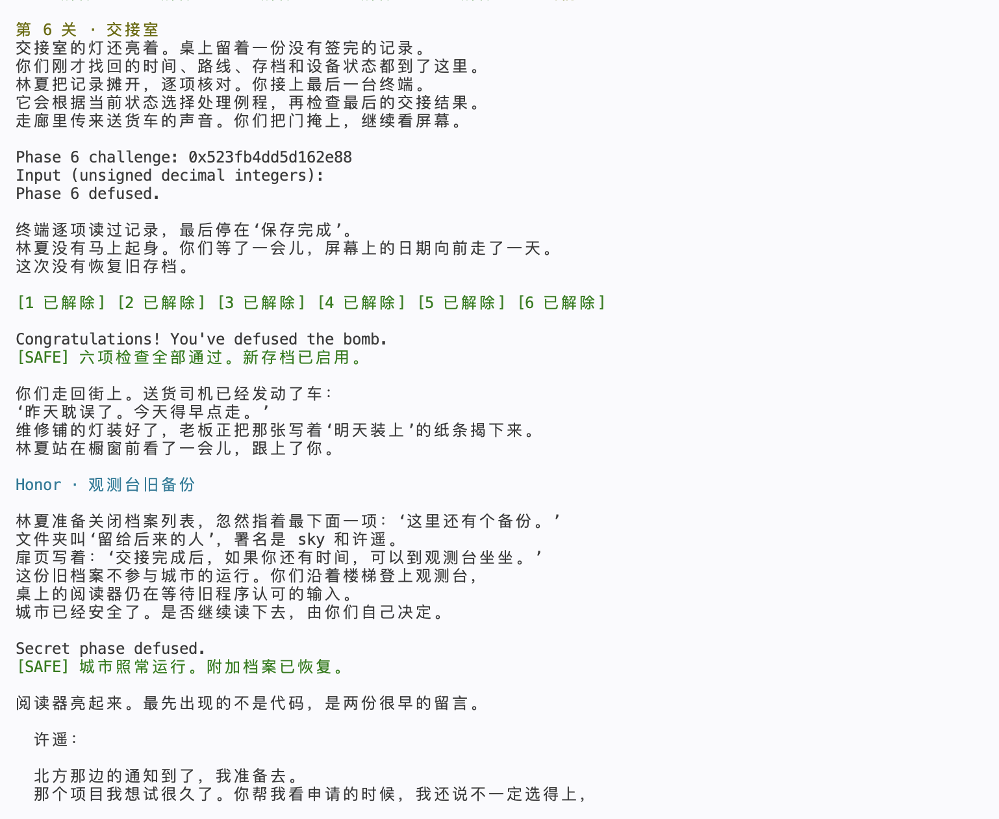

# BombLab 实验报告

姓名：姬健坤　学号：23301030045

## 实验环境与验证范围

实验在 GitHub Codespaces Linux 环境中进行，使用 GCC 编译，objdump 查看 Intel 风格反汇编，GDB 读取静态表和节点内存。个人 package_id 为 ae818461af5817fa8f128e80。

所有下述算术结果除 challenge、context 本身外均按 uint32_t 计算，保留低 32 位，右移采用逻辑右移。解法根据 challenge 计算口令，没有按公开 seed 保存答案表。

终端实际运行 `make && make test`：正式六关 Public tests: 60/60；Secret public tests: 10/10。另以公开列表之外的 seed 43 完整运行六关及 Honor，全部通过。公开测试通过不代表已经验证全部隐藏输入。

## 第一关：函数调用与参数传递

phase_01 在 0x40209d 设置字段数为 1；0x4020db 调用 p1_compute，0x4020e0 将返回值 eax 与输入整数比较。由 edi、esi 参数寄存器跟踪各调用，设 L=(uint32_t)c，H=(uint32_t)(c>>32)，M=(uint32_t)(c>>16)。

- p1_step2：`lea eax,[rsi+0x4b8]` 后 `xor eax,edi`，得到 A=(L+0x4b8)^H。
- p1_step0：`lea eax,[rdi+rsi*4]` 后异或 0xa64a，得到 B=(L+4M)^0xa64a。
- p1_step1：`lea eax,[rdi+rdi*2]`、`add eax,esi` 后异或 0x799。

故唯一输出为 (3B+A)^0x799。lea 在这些位置完成算术计算，并未解引用内存。

## 第二关：数组与递推

0x4020fd 设置六个输入字段。0x402160 用 0xf 掩码取得首项，故 v[0]=c&15。循环开始时 ecx=18、edi=9；`add edx,edx` 将上一项翻倍，`shr rax,cl` 和 `and eax,0x1f` 提取 challenge 的五位。

对 i=1..5：

```text
v[i] = (2*v[i-1] XOR ((c >> (18+5*(i-1))) & 31)) + 9*i
```

每轮移位数加 5、加数加 9、数组指针前进 4 字节。移位数达到 43 时退出，因此恰好产生后续五项。

## 第三关：跳转表

phase_03 要求两个字段：index=c&7，x=(uint32_t)(c>>32)^(uint32_t)(c>>3)。p3_dispatch 在 0x40224d 根据 0x405820 的八字节地址表跳转。不能把汇编排列顺序当成输入编号，必须读取表内容。

| index | 跳板地址 | case | 第二个输出 |
|---|---|---|---|
|0|0x402268|1|(x^0x5d46)+(x>>1)|
|1|0x402270|5|4*x^0xa7c1|
|2|0x402278|3|4*x^0xfc4d|
|3|0x402280|4|(x^0x1836)+(x>>1)|
|4|0x402288|0|5*x+0x8fba|
|5|0x402290|6|5*x+0xfbdc|
|6|0x402258|2|5*x+0x2b520|
|7|0x402260|7|5*x+0x221f|

例如 p3_case_1 的 shr 是逻辑右移；p3_case_0 的 lea 将乘五和加常量合并。输出依次为 index 和对应结果。

## 第四关：二分递归

phase_04 传入 target=c&127、low=0、high=127，key=(uint32_t)(c>>7)^(uint32_t)(c>>32)。p4_walk 的 sub、shr、add 形成 mid=low+((high-low)>>1)。

- 命中：0x402380 的 lea 与 xor 得到 (mid+0x9c)^key。
- target<mid：jb 进入左支，在 [low,mid-1] 递归；返回值乘五，异或 mid+key，再异或 0x18。
- target>mid：在 [mid+1,high] 递归；同样处理，但方向常量为 0x1d。

target 总在初始区间内，每次区间严格缩小，递归终止。uint32_t 保证递归返回时的乘加与 eax 回绕一致。

## 第五关：结构体与链表

p5_traverse 用 `mov rdx,[rax*8+0x405b60]` 选择起点。节点字段通过 [rdx]、[rdx+4]、[rdx+8] 读取，因此布局为 value:uint32_t、id:uint32_t、next:64位指针，每个节点 16 字节。

以 0x405ba0 为节点 0，每递增 16 字节编号加一。GDB 读出的静态数据如下；next 用节点编号表示，-1 是空指针。

|节点|value|id|next|
|---|---|---|---|
|0|0xfc1f|0xb2a|8|
|1|0xf2f0|0x450|11|
|2|0x12f3|0x272|-1|
|3|0xb464|0x835|1|
|4|0x7410|0xa31|7|
|5|0x9edc|0x37f|4|
|6|0x3f44|0x547|5|
|7|0x8134|0x02c|3|
|8|0xbc76|0x95c|9|
|9|0x3f28|0x667|2|
|10|0x85d8|0x728|0|
|11|0xc0b4|0x11b|10|

八个起点依次为 [6,5,4,7,3,1,11,10]，按 c&7 选择。初始 acc=(uint32_t)(c>>6)^(uint32_t)(c>>32)^0xfbd4。每访问一个节点执行 acc=(3*acc+value)^id，先访问起点，再前进 (c>>3)&3 次，总计 1 至 4 个节点。输出 acc 和末节点 id。由起点表及链关系可检查，最多前进三次不会越过空指针。

## 第六关：函数指针与间接调用

p6_dispatch 在 0x402586 和 0x402594 两次间接调用。0x405e00 的函数表对应操作编号 [0,2,5,0,2,4,3,1]，并非简单的 0..7 顺序。

|操作|计算|
|---|---|
|0|((x>>3)^x)+0xcd83|
|1|ROL32(x,3)^0x8f9c|
|2|(x^0x3cef)+4*x|
|3|(x+0xa26d)^(x>>1)|
|4|ROR32(x,3)|
|5|(4*x+0x1a98)^(7*x)|

ROL32/ROR32 分别对应 rol/ror 指令，需保留移出后回到另一端的位。设 F 是按表索引选择的运算，x=(uint32_t)(c>>6)^(uint32_t)(c>>32)，first=c&7，second=(c>>3)&7，则输出 F(second,F(first,x)^0x774)+0xc562。

## Honor：相邻字段与混合校验

secret_gate 从 rbp-0xd0 开始复制字符串，随后在 rbp-0xb0 检查 0x4e45504f，两者相距 32 字节。x86 小端序中该常量的字节依次为 OPEN。secret_phase 收到的字符串地址是 rbp-0xac，即再向后四字节。

因此构造 32 个 A、OPEN、空格和三个十进制整数。secret_copy 逐字节复制并包含结束零；构造的总长度在入口允许的 36..163 字节内，且仅覆盖该局部对象内所需字段，不涉及返回地址。

设 c=challenge，s=context：

```text
a = low32(c) XOR high32(c)
b = low32(s) XOR high32(s)
i = low32(s) & 3
x = a XOR b
m = (ROL32(x,1) + 0xcaa6) XOR 0xb39c
second = m XOR (i*0xcaa6) XOR low32(s>>16)
third = second XOR (b+i+0xb39c+(a>>1))
```

secret_phase 先比较第一个整数是否等于 context&3，调用 secret_mix 后检查 second，再通过 shr、lea、add、xor 检查 third。三个整数按 i、second、third 的顺序输出。context 由驱动根据前六行计算，求解函数直接使用传入的 context，无需猜测或固定它。

## 非公开 seed 的实际验证及截图

公开列表为 0、1、7、42、99、123、2026、65535、987654321、18446744073709551615。额外选用 43，执行：

```bash
{ ./defuser --seed 43; ./defuser --secret --seed 43; } | ./bomb --seed 43
```

|关卡|seed 43 的 challenge|实际结果|
|---|---|---|
|1|0x9cde98852e60034b|Phase 1 defused.|
|2|0x6ec624aa85685867|Phase 2 defused.|
|3|0xd49ffe504bfdab7f|Phase 3 defused.|
|4|0x006ff81b72d591ff|Phase 4 defused.|
|5|0x18e47d0995aecbfe|Phase 5 defused.|
|6|0x523fb4dd5d162e88|Phase 6 defused.|
|Honor|终端不打印该 challenge|Secret phase defused.|

运行命令：



第一、二关：



第三、四关：



第五、六关：



Honor：



## 资料和工具

- [课程实验文档](https://ics-26fall-fdu.github.io/labs/lab2-bomb-lab/)：实验接口、提交要求和调试方法。
- [官方模板](https://github.com/ICS-26Fall-FDU/BombLab)：驱动、公开测试及函数接口。
- objdump：读取函数指令；GDB：读取跳转表、函数指针表和链表节点；GCC、make、public_test.py：编译与实际测试。

